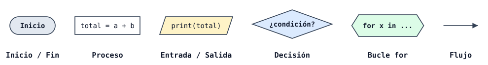
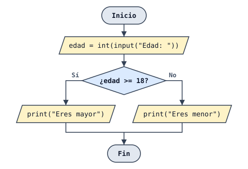
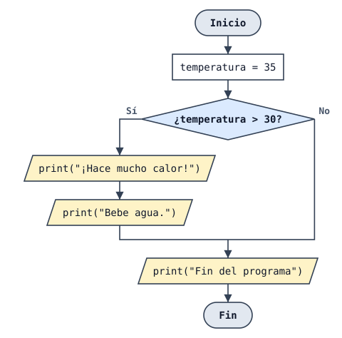
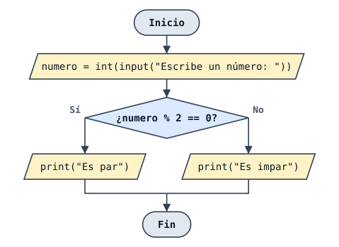
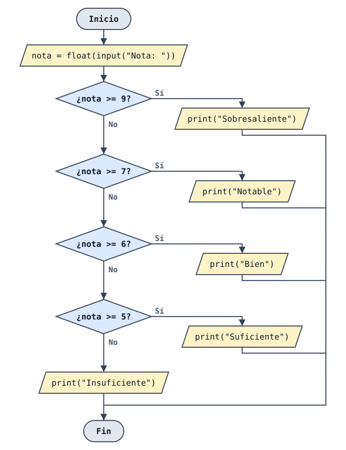
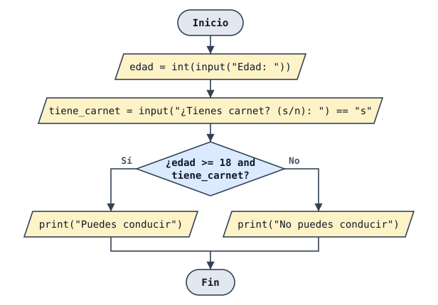
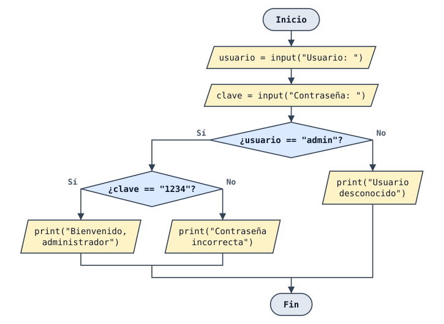
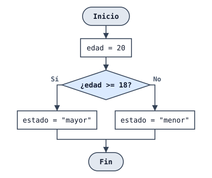
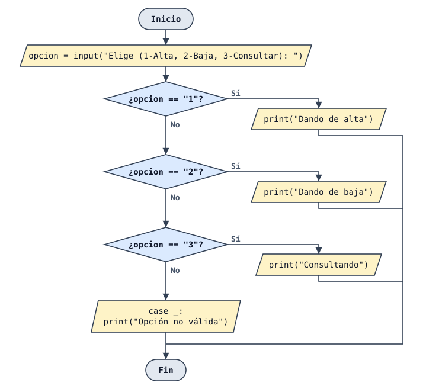

# a) Estructuras de selección

## 1. Flujo de control y diagramas de flujo

El **flujo de control** es el orden en que se ejecutan las instrucciones. Puede ser:

- **Secuencial**: una tras otra (lo que has hecho hasta ahora).
- **Selección**: se ejecuta un bloque **u otro** según una condición.
- **Repetición**: un bloque se ejecuta **varias veces** (apartado b).

### Diagramas de flujo

Para **ver** el flujo de cada estructura usaremos en toda la unidad **diagramas de flujo**. El programa se dibuja con unas pocas figuras unidas por **flechas**, que indican qué instrucción va después de cuál:



| Símbolo | Forma | Qué representa |
|---|---|---|
| **Inicio / Fin** | Óvalo | Dónde empieza y dónde termina el programa. |
| **Proceso** | Rectángulo | Un cálculo o una asignación: `total = a + b`. |
| **Entrada / Salida** | Paralelogramo | Pedir datos (`input`) o mostrarlos (`print`). |
| **Decisión** | Rombo | Una condición. Salen dos flechas: **Sí** y **No**. |
| **Bucle `for`** | Hexágono | Recorrer una secuencia: se repite mientras queden valores. |
| **Flujo** | Flecha | El camino que sigue la ejecución. |

!!! note "Solo para leer el flujo"
    No tienes que memorizar los símbolos ni dibujarlos a la perfección: los usamos para **entender en qué orden se ejecuta cada instrucción**.
    Para seguir un diagrama, pon el dedo en **Inicio** y ve siguiendo las flechas hasta **Fin**.

Por ejemplo, un programa que dice si eres mayor o menor de edad:



## 2. Condicional simple: `if`

Ejecuta un bloque **solo si** la condición es verdadera.

```python
temperatura = 35

if temperatura > 30:
    print("¡Hace mucho calor!")
    print("Bebe agua.")

print("Fin del programa")
```



La flecha del **No** no pasa por ninguna instrucción: si la condición es falsa, se va directamente a `print("Fin del programa")`.

```text
if condición:
    bloque      ← se ejecuta solo si la condición es True
```

- La condición es una **expresión** que da `True` o `False` (comparaciones, `and`, `or`, `not`...).
- Los **dos puntos** `:` al final de la línea son obligatorios.
- El bloque va **indentado** (4 espacios). Cuando vuelve al margen, acaba el `if`.

!!! note "Se puede usar cualquier valor como condición"
    Recuerda los valores *truthy* y *falsy* de la UT01: `if nombre:` es `True` si `nombre` no está vacío.

## 3. Condicional doble: `if ... else`

Elige entre **dos caminos**: uno si la condición es verdadera y otro si es falsa.

```python
numero = int(input("Escribe un número: "))

if numero % 2 == 0:
    print("Es par")
else:
    print("Es impar")
```



Con `if ... else` **siempre se ejecuta exactamente uno de los dos bloques**: ahora las dos flechas pasan por una instrucción antes de volver a juntarse.

## 4. Condicional múltiple: `if ... elif ... else`

Para más de dos caminos. Python evalúa las condiciones **de arriba abajo** y ejecuta **solo el primer bloque** cuya condición sea verdadera; el resto se ignora.

```python
nota = float(input("Nota: "))

if nota >= 9:
    print("Sobresaliente")
elif nota >= 7:
    print("Notable")
elif nota >= 6:
    print("Bien")
elif nota >= 5:
    print("Suficiente")
else:
    print("Insuficiente")
```

En el diagrama de flujo, cada `elif` es un **nuevo rombo en el camino del No** del anterior. Así se ve que, en cuanto una condición se cumple, las de más abajo ya no se miran:



!!! warning "El orden importa"
    Si pusieras `nota >= 5` la primera, un 9,5 mostraría «Suficiente», porque esa condición ya se cumple y Python no sigue mirando.
    Ordena las condiciones de la **más restrictiva a la más general**.

## 5. Condiciones compuestas y anidamiento

### Condiciones compuestas

Une varias comprobaciones con `and`, `or` y `not`:

```python
edad = int(input("Edad: "))
tiene_carnet = input("¿Tienes carnet? (s/n): ") == "s"

if edad >= 18 and tiene_carnet:
    print("Puedes conducir")
else:
    print("No puedes conducir")
```



La forma del diagrama es la de un `if ... else` normal: toda la condición compuesta se evalúa **de una vez** y da un único `True` o `False`.

Para rangos, la comparación encadenada es muy legible: `if 1 <= mes <= 12:`.

**Ejemplo: año bisiesto.** Es bisiesto si es divisible por 4, salvo los divisibles por 100 que no lo sean también por 400:

```python
anio = int(input("Año: "))

if (anio % 4 == 0 and anio % 100 != 0) or anio % 400 == 0:
    print("Bisiesto")
else:
    print("No bisiesto")
```

### Condicionales anidados

Un `if` dentro de otro `if`:

```python
usuario = input("Usuario: ")
clave = input("Contraseña: ")

if usuario == "admin":
    if clave == "1234":
        print("Bienvenido, administrador")
    else:
        print("Contraseña incorrecta")
else:
    print("Usuario desconocido")
```

En el diagrama de flujo el anidamiento se ve claramente: un rombo **dentro** del camino del Sí de otro.



!!! tip "Evita anidar de más"
    Muchos niveles de anidamiento dificultan la lectura. Si puedes, usa `and` o `elif` para aplanar el código:

    ```python
    if usuario == "admin" and clave == "1234":
        print("Bienvenido, administrador")
    else:
        print("Datos incorrectos")
    ```

## 6. Expresión condicional (operador ternario)

Una forma abreviada de elegir **un valor** según una condición, en una sola línea:

```text
valor_si_verdadero  if  condición  else  valor_si_falso
```

```pycon
>>> edad = 20
>>> estado = "mayor" if edad >= 18 else "menor"
>>> estado
'mayor'
>>> print("Par" if 7 % 2 == 0 else "Impar")
Impar
```

Su flujo es el de un `if ... else`, pero cada camino solo **produce un valor**:



Úsala para asignaciones sencillas. Si la lógica es más compleja, un `if` normal se lee mejor.

## 7. Selección múltiple: `match ... case`

Desde **Python 3.10**, `match` permite comparar un valor con varios patrones. Es más cómodo que una cadena de `elif` cuando se compara **la misma variable con valores concretos** (por ejemplo, un menú).

```python
opcion = input("Elige (1-Alta, 2-Baja, 3-Consultar): ")

match opcion:
    case "1":
        print("Dando de alta")
    case "2":
        print("Dando de baja")
    case "3":
        print("Consultando")
    case _:
        print("Opción no válida")
```



Su flujo es igual que el de una cadena de `elif`: se compara `opcion` con cada caso, de arriba abajo, y se ejecuta **solo el primero** que coincide. Si ninguno coincide, se llega a `case _`, que recoge todo lo demás.

- `case _:` es el **comodín**: se ejecuta si ningún otro caso coincide (como el `else`).
- Se pueden agrupar varios valores con `|` (o):

```python
dia = input("Día de la semana: ")

match dia:
    case "sábado" | "domingo":
        print("Fin de semana")
    case "lunes" | "martes" | "miércoles" | "jueves" | "viernes":
        print("Día laborable")
    case _:
        print("Día no válido")
```


!!! warning "Versión de Python"
    `match` no funciona en versiones anteriores a la 3.10 (daría `SyntaxError`). Comprueba la tuya con `python --version`.

## 8. Errores comunes

| Error | Ejemplo | Solución |
|---|---|---|
| Usar `=` en lugar de `==` | `if x = 5:` → `SyntaxError` | `if x == 5:` |
| Olvidar los dos puntos | `if x > 5` → `SyntaxError` | `if x > 5:` |
| Indentación incorrecta | Bloque sin sangrar → `IndentationError` | 4 espacios en cada línea del bloque |
| Comparar texto con número | `input()` da `"5"` y `"5" == 5` es `False` | Convertir: `int(input())` |
| `if x == 1 or 2:` | Siempre es verdadero (`2` es *truthy*) | `if x == 1 or x == 2:` o `if x in (1, 2):` |
| `else` mal alineado | Queda dentro de otro bloque | Alinéalo con el `if` al que pertenece |

## Resumen

- `if` ejecuta un bloque si la condición es verdadera; `else` es la alternativa; `elif` añade condiciones intermedias.
- Solo se ejecuta **el primer bloque** que cumple; el orden de las condiciones importa.
- Combina condiciones con `and`, `or` y `not`; evita anidar en exceso.
- `a if condición else b` elige un valor en una línea.
- `match` / `case` (3.10+) es una alternativa a los `elif` encadenados; `case _` es el comodín.
