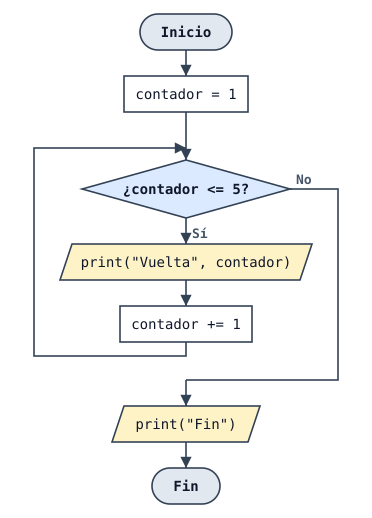
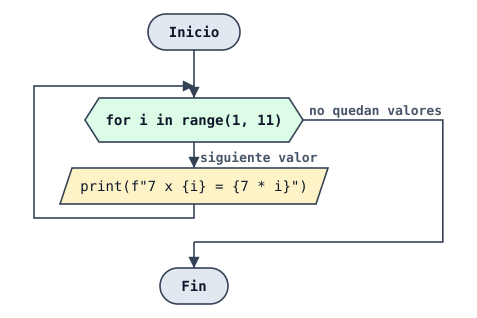
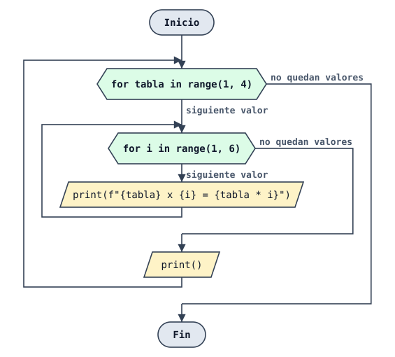

# b) Estructuras de repetición

## 1. Concepto de bucle

Un **bucle** repite un bloque de instrucciones. Cada pasada se llama **iteración**. Hay que decidir siempre **cuándo parar**: la **condición de parada**.

Sin bucles, mostrar los números del 1 al 100 exigiría 100 líneas. Con un bucle, bastan tres.

```text
 Bucle while                    Bucle for
 ───────────                    ─────────
 mientras condición:            para cada elemento de una secuencia:
     repetir bloque                 repetir bloque
 (no sé cuántas veces)          (sé cuántas veces)
```

## 2. Bucle `while`

Repite el bloque **mientras** la condición sea verdadera. La condición se comprueba **antes de cada iteración**.

```python
contador = 1

while contador <= 5:
    print("Vuelta", contador)
    contador += 1

print("Fin")
```

Salida:

```text
Vuelta 1
Vuelta 2
Vuelta 3
Vuelta 4
Vuelta 5
Fin
```

En el diagrama de flujo, el bucle se reconoce por la **flecha que vuelve hacia arriba**: tras el cuerpo, se regresa al rombo de la condición. Cuando la condición deja de cumplirse, se sale por el **No**.



Un `while` bien hecho tiene tres piezas:

1. **Inicialización**: `contador = 1`.
2. **Condición**: `contador <= 5`.
3. **Actualización** dentro del bucle: `contador += 1`.

!!! warning "Bucle infinito"
    Si olvidas la actualización (o la condición nunca deja de cumplirse), el bucle **no termina nunca**.
    Para pararlo: `Ctrl+C` en la terminal, o el botón **Interrumpir** (⏹) en Jupyter.

### Bucle controlado por condición

Se repite hasta que ocurra algo, sin saber cuántas veces:

```python
# Pedir una contraseña hasta que sea correcta
clave = input("Contraseña: ")

while clave != "python":
    print("Incorrecta")
    clave = input("Contraseña: ")

print("Acceso concedido")
```

### Bucle con valor centinela

Un **centinela** es un valor especial que indica «ya no hay más datos». Aquí, el `0`:

```python
suma = 0
numero = int(input("Número (0 para terminar): "))

while numero != 0:
    suma += numero
    numero = int(input("Número (0 para terminar): "))

print("La suma es", suma)
```

### Bucle `while True`

Un bucle intencionadamente infinito que se corta desde dentro con `break` (lo verás en el [apartado c](c-salto.md)). Es la base de los menús:

```python
while True:
    texto = input("Escribe algo (salir para terminar): ")
    if texto == "salir":
        break
    print("Has escrito:", texto)
```

!!! success "Ahora tú"
    **Ahorrando para una consola.** Construye un programa que:

    1. Pida el precio de la consola y cuánto dinero puedes ahorrar cada semana.
    2. Simule el ahorro semana a semana con un `while`, mostrando en cada vuelta:

        ```text
        Semana 1: llevas 25.00 €
        Semana 2: llevas 50.00 €
        ...
        ```

    3. Al terminar, muestre `¡Ya puedes comprarla! Has tardado X semanas.`

## 3. Bucle `for`

Recorre **cada elemento** de una secuencia (o de cualquier objeto *iterable*), ejecutando el bloque una vez por elemento.

```pycon
>>> for letra in "hola":
...     print(letra)
...
h
o
l
a
```

```text
for variable in secuencia:
    bloque      ← se ejecuta una vez por cada elemento
```

- La `variable` toma en cada vuelta el valor del elemento siguiente.
- El bucle termina solo, cuando se acaba la secuencia.

!!! note "Adelanto"
    Con las listas, tuplas y diccionarios de la UT04 el `for` será todavía más útil.

!!! success "Ahora tú"
    **Analizador de frases.** Construye un programa que pida una frase y, recorriéndola con un `for` letra a letra, cuente:

    - Cuántas **vocales** tiene (incluidas las mayúsculas y las vocales con tilde).
    - Cuántos **espacios** tiene.
    - Cuántos **dígitos** tiene.

    ```text
    Frase: Tengo 2 gatos y 1 perro
    Vocales: 6
    Espacios: 5
    Dígitos: 2
    ```

    Pista: recuerda el operador `in` de la UT01: `letra in "aeiouáéíóúAEIOUÁÉÍÓÚ"` es `True` si `letra` es una vocal.

## 4. La función `range()`

Genera una **secuencia de números**, ideal para repetir algo un número exacto de veces.

| Forma | Genera | Ejemplo |
|---|---|---|
| `range(fin)` | De 0 a `fin - 1` | `range(5)` → 0, 1, 2, 3, 4 |
| `range(inicio, fin)` | De `inicio` a `fin - 1` | `range(1, 6)` → 1, 2, 3, 4, 5 |
| `range(inicio, fin, paso)` | Saltando de `paso` en `paso` | `range(0, 10, 2)` → 0, 2, 4, 6, 8 |

!!! warning "El valor final **no** se incluye"
    `range(1, 6)` llega hasta el 5. Para contar del 1 al 10 hay que escribir `range(1, 11)`.

```pycon
>>> list(range(5))
[0, 1, 2, 3, 4]
>>> list(range(1, 6))
[1, 2, 3, 4, 5]
>>> list(range(10, 0, -2))        # paso negativo: cuenta hacia atrás
[10, 8, 6, 4, 2]
```

```python
# Tabla de multiplicar del 7
for i in range(1, 11):
    print(f"7 x {i} = {7 * i}")
```



```python
# Repetir 3 veces (no usamos la variable, se suele llamar _)
for _ in range(3):
    print("¡Hola!")
```

!!! tip "¿`for` o `while`?"
    - Sabes **cuántas veces** repetir (o recorres una secuencia) → `for`.
    - Repites **hasta que ocurra algo** que no sabes cuándo → `while`.

!!! success "Ahora tú"
    **Tabla de conversión de temperaturas.** Construye un programa que muestre una tabla de grados Celsius a Fahrenheit (`F = C * 9 / 5 + 32`):

    1. Desde **-10 °C hasta 40 °C**, ambos incluidos, **de 5 en 5**.
    2. Cada fila con este formato, con las columnas alineadas:

        ```text
          -10 °C =   14.0 °F
           -5 °C =   23.0 °F
        ...
           40 °C =  104.0 °F
        ```

    3. Después, muestra la misma tabla **al revés** (de 40 a -10) usando un paso negativo.

    Piensa bien el segundo argumento de `range()`: recuerda que el final **no** se incluye.

## 5. Bucles anidados

Un bucle dentro de otro. Por cada vuelta del **externo**, el **interno** se ejecuta entero.

```python
# Tablas de multiplicar del 1 al 3
for tabla in range(1, 4):
    for i in range(1, 6):
        print(f"{tabla} x {i} = {tabla * i}")
    print()      # línea en blanco entre tablas
```

En el diagrama se ve un **bucle dentro de otro**, cada uno con su flecha de vuelta. El `print()` está dentro del bucle externo pero fuera del interno: se ejecuta una vez por cada tabla.



```python
# Triángulo de asteriscos
for fila in range(1, 5):
    print("*" * fila)
```

```text
*
**
***
****
```

Con `end=""` en `print` no se salta de línea al final, útil para dibujar filas:

```python
for fila in range(1, 4):
    for col in range(1, 4):
        print("#", end=" ")
    print()          # salto de línea al terminar la fila
```

```text
# # # 
# # # 
# # # 
```

!!! success "Ahora tú"
    **Tablero de ajedrez.** Construye un programa que pida un tamaño `n` y dibuje un tablero de `n × n` casillas alternando `#` (casilla negra) y `.` (casilla blanca):

    ```text
    Tamaño: 5
    # . # . #
    . # . # .
    # . # . #
    . # . # .
    # . # . #
    ```

    Usa un `for` para las filas y otro dentro para las columnas.
    Pista: una casilla es negra cuando `(fila + columna) % 2 == 0`.

    Ampliación: pide también el carácter de las casillas negras y el de las blancas.


## 6. Patrones típicos

Casi todos los problemas con bucles usan uno de estos esquemas.

### Contador: cuántas veces ocurre algo

```python
pares = 0
for n in range(1, 21):
    if n % 2 == 0:
        pares += 1
print("Pares del 1 al 20:", pares)     # 10
```

### Acumulador: sumar (o multiplicar) valores

```python
suma = 0
for n in range(1, 101):
    suma += n
print("Suma del 1 al 100:", suma)      # 5050
```

### Máximo y mínimo

Se parte del primer dato como «mejor hasta ahora» y se compara con los siguientes:

```python
cantidad = int(input("¿Cuántos números? "))
mayor = int(input("Número: "))          # el primero es el mayor de momento

for _ in range(cantidad - 1):
    n = int(input("Número: "))
    if n > mayor:
        mayor = n

print("El mayor es", mayor)
```

### Media

```python
suma = 0
cantidad = 5
for i in range(cantidad):
    suma += float(input(f"Nota {i + 1}: "))
print(f"Media: {suma / cantidad:.2f}")
```

### Validación de una entrada

Repetir la pregunta hasta que el dato sea válido:

```python
edad = int(input("Edad (0-120): "))

while edad < 0 or edad > 120:
    print("Edad no válida")
    edad = int(input("Edad (0-120): "))
```

!!! tip "Traza tus bucles a mano"
    Si un bucle no hace lo que esperas, apunta en un papel el valor de cada variable **en cada vuelta**. Es la mejor forma de encontrar el fallo.
    En VS Code puedes hacerlo con el depurador (lo verás en el [apartado d](d-excepciones.md#10-depuracion-basica)).

!!! success "Ahora tú"
    **Control de gastos del mes.** Construye un programa que pida los gastos del mes uno a uno, hasta que se escriba `0` (centinela), y al final muestre:

    | Dato | Patrón que usas |
    |---|---|
    | Número de gastos introducidos | Contador |
    | Total gastado | Acumulador |
    | Gasto más alto | Máximo |
    | Cuántos gastos superan los 50 € | Contador con condición |
    | Gasto medio | Media (¡cuidado si no hay gastos!) |

    Los gastos negativos no son válidos: avisa y vuelve a pedir el dato (validación).

    ```text
    Gasto (0 para terminar): 12.5
    Gasto (0 para terminar): 80
    Gasto (0 para terminar): -4
    Gasto no válido
    Gasto (0 para terminar): 30
    Gasto (0 para terminar): 0
    Gastos: 3 | Total: 122.50 € | Mayor: 80.00 € | Más de 50 €: 1 | Media: 40.83 €
    ```

## Resumen

- `while` repite **mientras** se cumpla una condición; necesita inicialización, condición y actualización.
- `for` recorre una secuencia; con `range(inicio, fin, paso)` repites un número exacto de veces (el `fin` **no** se incluye).
- Los bucles se pueden **anidar**.
- Patrones: contador, acumulador, máximo/mínimo, media, centinela y validación de entradas.
