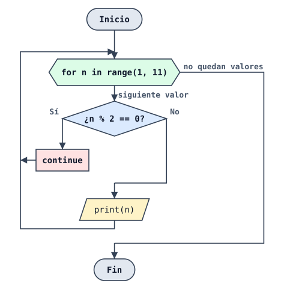

# c) Estructuras de salto

Las sentencias de salto **alteran el funcionamiento normal de un bucle**: salir de él antes de tiempo, saltarse una vuelta o dejar un hueco vacío.

## 1. `break`: salir del bucle

`break` **termina el bucle inmediatamente** y el programa continúa con la primera instrucción posterior.

```python
# Buscar el primer múltiplo de 7 entre 50 y 100
for n in range(50, 101):
    if n % 7 == 0:
        print("El primero es", n)
        break
```

```text
El primero es 56
```

En el diagrama de flujo, la flecha del `break` **sale del bucle** y se une al camino de salida, aunque queden valores por recorrer.


!!! warning "`break` solo sale del bucle más interno"
    En bucles anidados, `break` termina **únicamente el bucle en el que está**, no todos.

## 2. `continue`: saltar a la siguiente iteración

`continue` **se salta el resto del bloque** en la vuelta actual y pasa directamente a la siguiente iteración.

```python
# Mostrar solo los números impares del 1 al 10
for n in range(1, 11):
    if n % 2 == 0:
        continue          # los pares se saltan
    print(n)
```

```text
1
3
5
7
9
```

Cuando se llega al `continue`, el resto del cuerpo (`print(n)`) se salta y la flecha vuelve al inicio del bucle, con el siguiente valor:



Con `while` hay que tener cuidado de actualizar el contador **antes** del `continue`, o el bucle se quedará atascado:

```python
i = 0
while i < 10:
    i += 1                # ← actualizamos antes del continue
    if i % 2 == 0:
        continue
    print(i)
```

## 3. Uso adecuado de las sentencias de salto

`break` y `continue` son útiles, pero abusar de ellos complica seguir el flujo del programa.

| Situación | Recomendación |
|---|---|
| Buscar algo y parar al encontrarlo | `break` es adecuado. |
| Menú que se repite hasta elegir «salir» | `while True` + `break`. |
| Saltar elementos que no interesan | `continue` va bien si evita anidar demasiado. |
| Varios `break`/`continue` en el mismo bucle | Replantea la condición del bucle: quizá se lea mejor. |

Alternativas que a veces dan un código más claro:

**Usar una variable «bandera»** (*flag*) que controle el bucle:

```python
salir = False
while not salir:
    opcion = input("Opción (s para salir): ")
    if opcion == "s":
        salir = True
    else:
        print("Has elegido", opcion)
```

**Poner la condición de parada en el propio `while`:**

```python
# En lugar de while True + break
texto = input("Texto (fin para terminar): ")
while texto != "fin":
    print("Recibido:", texto)
    texto = input("Texto (fin para terminar): ")
```

**Usar `continue` con moderación**, mejor un `if` positivo:

```python
# Con continue
for n in range(1, 11):
    if n % 2 == 0:
        continue
    print(n)

# Sin continue (igual de claro)
for n in range(1, 11):
    if n % 2 != 0:
        print(n)
```

## Resumen

| Sentencia | Efecto |
|---|---|
| `break` | Sale del bucle actual. |
| `continue` | Salta a la siguiente iteración. |
| `pass` | No hace nada (marcador de posición). |

Úsalas cuando simplifiquen el código, no como sustituto de una buena condición de bucle.
