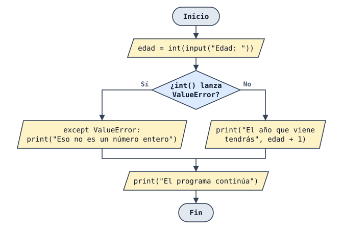
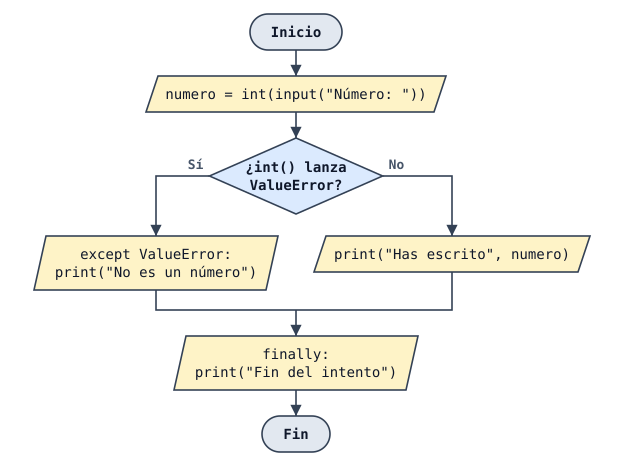
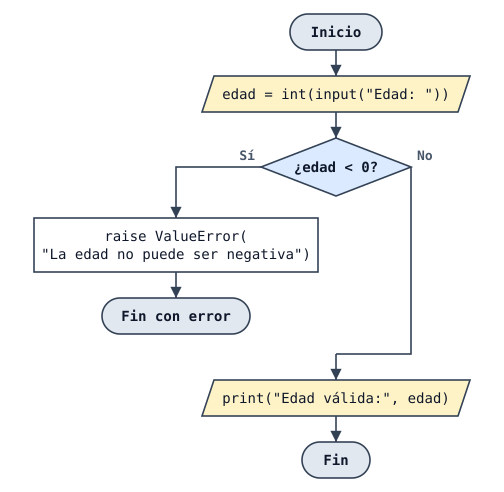
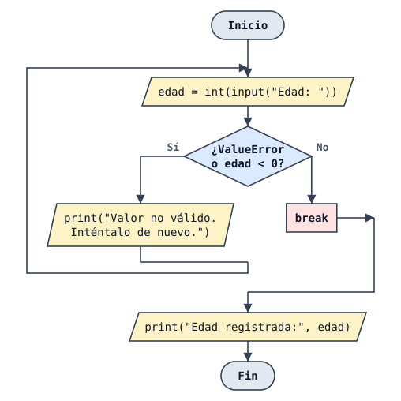

# d) Control de excepciones

## 1. Error, excepción y traza

Cuando algo sale mal durante la ejecución, Python **lanza una excepción** y el programa **se detiene** mostrando un mensaje llamado **traza** (*traceback*).

```text
Traceback (most recent call last):
  File "edad.py", line 2, in <module>
    edad = int(input("Edad: "))
ValueError: invalid literal for int() with base 10: 'abc'
```

**Cómo leer una traza: de abajo hacia arriba.**

1. La **última línea** dice el **tipo de error** y el motivo: `ValueError: invalid literal for int()...`.
2. Las líneas de arriba indican **dónde**: archivo, número de línea y la instrucción que falló.

!!! success "Los errores son información, no fracasos"
    Leer bien la última línea de la traza resuelve la mayoría de los fallos. **Aprende a leerla**: sin internet en los proyectos, será tu guía.

## 2. Tipos de errores

| Tipo | Cuándo aparece | Ejemplo |
|---|---|---|
| **Sintaxis** | **Antes** de ejecutar: el código está mal escrito. | `print("hola"` (falta cerrar el paréntesis) |
| **Ejecución** (excepciones) | **Durante** la ejecución: el código es correcto pero algo falla. | `int("abc")`, `10 / 0` |
| **Lógicos** | El programa funciona pero **da un resultado equivocado**. Python no avisa. | Calcular la media dividiendo entre 2 cuando hay 3 notas |

Los errores de **sintaxis** los corriges tú. Los **lógicos** los detectas probando. Las **excepciones** son las que puedes **controlar** desde el programa.

## 3. Excepciones más comunes

| Excepción | Cuándo ocurre | Ejemplo |
|---|---|---|
| `ValueError` | El valor no se puede convertir o no es válido. | `int("abc")` |
| `TypeError` | Operación con un tipo no permitido. | `"5" + 3` |
| `ZeroDivisionError` | División (o resto) entre cero. | `10 / 0` |
| `NameError` | Se usa una variable que no existe. | `print(saldo)` sin haberla creado |
| `IndexError` | Índice fuera de rango en una secuencia. | `"hola"[10]` |
| `KeyError` | Clave inexistente en un diccionario (UT04). | `datos["clave"]` |
| `FileNotFoundError` | El fichero no existe (UT05). | `open("no_existe.txt")` |

```pycon
>>> 10 / 0
Traceback (most recent call last):
  ...
ZeroDivisionError: division by zero
>>> "hola"[10]
Traceback (most recent call last):
  ...
IndexError: string index out of range
```

!!! success "Ahora tú"
    **Colección de errores.** Construye un programa `errores.py` que tenga **una línea que provoque cada una** de estas excepciones: `ValueError`, `TypeError`, `ZeroDivisionError`, `NameError` e `IndexError`.

    1. Escribe todas las líneas comentadas con `#`.
    2. Quita el comentario de **una sola**, ejecuta y apunta en un comentario, al lado de esa línea, la **última línea de la traza**.
    3. Vuelve a comentarla y repite con la siguiente.

## 4. `try` ... `except`

Permite **intentar** un código y **decidir qué hacer si falla**, en lugar de que el programa se detenga.

```python
try:
    edad = int(input("Edad: "))
    print("El año que viene tendrás", edad + 1)
except ValueError:
    print("Eso no es un número entero")

print("El programa continúa")
```

Funcionamiento:

1. Se ejecuta el bloque `try`.
2. Si **no hay error**, se salta el `except`.
3. Si **hay un error** del tipo indicado, se abandona el `try` en ese punto y se ejecuta el `except`.
4. El programa **continúa** después.

Los diagramas de flujo no tienen un símbolo propio para las excepciones. Se dibujan como una **decisión**: «¿ha fallado la instrucción?».



Si `int()` falla, el resto del `try` **no se ejecuta**: se va directamente al `except`. Si no falla, el `except` se ignora.

### Varios `except`

Cada tipo de error puede tener su propio tratamiento:

```python
try:
    a = int(input("Dividendo: "))
    b = int(input("Divisor: "))
    print("Resultado:", a / b)
except ValueError:
    print("Debes escribir números enteros")
except ZeroDivisionError:
    print("No se puede dividir entre cero")
```

### Agrupar excepciones

```python
try:
    # ...
    pass
except (ValueError, TypeError):
    print("Dato incorrecto")
```

### Ver el mensaje del error

```python
try:
    numero = int(input("Número: "))
except ValueError as error:
    print("Ha ocurrido un error:", error)
```

!!! warning "Captura errores concretos"
    Evita el `except:` a secas (o `except Exception:`) como norma: captura **cualquier** error, incluso los que no esperabas, y esconde fallos reales.
    Indica siempre el tipo (`except ValueError:`).

!!! success "Ahora tú"
    **Deletreador seguro.** Construye un programa que pida una palabra y una posición, y muestre la letra que hay en esa posición:

    ```text
    Palabra: teclado
    Posición: 2
    En la posición 2 está la letra 'c'
    ```

    El programa **nunca debe detenerse con una traza**. Trata por separado:

    - Que la posición no sea un número entero → `La posición debe ser un número entero`.
    - Que la posición no exista en la palabra → `La palabra solo tiene X letras`.

    Pista: provoca antes los dos errores a propósito para saber **qué excepción** lanza cada uno.

## 5. Cláusula `finally`

Después de los `except` se puede añadir un bloque `finally`, que se ejecuta **siempre**, haya error o no:

```python
try:
    numero = int(input("Número: "))
    print("Has escrito", numero)
except ValueError:
    print("No es un número")
finally:
    print("Fin del intento")            # SIEMPRE se ejecuta
```



| Cláusula | Se ejecuta... |
|---|---|
| `try` | Siempre, hasta que ocurra un error. |
| `except` | Solo si hubo un error del tipo indicado. |
| `finally` | **Siempre**, haya error o no. Se usa para «limpiar» (cerrar ficheros, conexiones...). |

### ¿Para qué sirve `finally`?

En el ejemplo anterior, el `print("Fin del intento")` daría el mismo resultado escrito **después** del `try`, sin `finally`. Entonces, ¿para qué sirve?

La diferencia aparece cuando el programa **no llega** a la línea siguiente al `try`. `finally` se ejecuta **igualmente** en dos casos en los que el código de después no se ejecuta:

**Caso 1. Se produce un error que ningún `except` captura.**

```python
try:
    a = int(input("Dividendo: "))
    b = int(input("Divisor: "))
    print("Resultado:", a / b)
except ValueError:
    print("Debes escribir números enteros")
finally:
    print("Operación terminada")

print("Fin del programa")
```

Solo se captura `ValueError`. Observa qué pasa con cada entrada:

| Entrada | Salida |
|---|---|
| `10` y `2` | `Resultado: 5.0` → `Operación terminada` → `Fin del programa` |
| `10` y `hola` | `Debes escribir números enteros` → `Operación terminada` → `Fin del programa` |
| `10` y `0` | `Operación terminada` → **traza de `ZeroDivisionError`** y el programa se detiene |

En el tercer caso, el error no se captura y el programa se detiene. Aun así, **antes de detenerse, Python ejecuta el `finally`**. En cambio, `print("Fin del programa")` no llega a ejecutarse.


**Caso 2. Se sale del bucle con `break` desde dentro del `try`.**

```python
while True:
    try:
        texto = input("Número (fin para salir): ")
        if texto == "fin":
            break
        print("El doble es", int(texto) * 2)
    except ValueError:
        print("Eso no es un número")
    finally:
        print("--- intento terminado ---")
```

```text
Número (fin para salir): 4
El doble es 8
--- intento terminado ---
Número (fin para salir): fin
--- intento terminado ---
```

Aunque el `break` saca del bucle, el `finally` se ejecuta **antes de salir**.

!!! tip "¿Cuándo usar `finally`?"
    Para las tareas de **cierre** que no pueden quedarse sin hacer: cerrar un fichero (lo verás en la UT05), desconectarse de un servidor, guardar un registro o avisar al usuario de que la operación ha terminado.

!!! success "Ahora tú"
    **Terminal de pedidos de una cafetería.** Un café cuesta 1,40 €. Construye un programa que:

    1. En el `try`, pida cuántos cafés quiere el cliente.
    2. En el `except`, avise si no ha escrito un número entero.
    3. También en el `try`, muestre el total a pagar con 2 decimales.
    4. En el `finally`, muestre siempre `Gracias por su visita`.

    Ejecútalo dos veces: una con `3` y otra con `tres`. Compara qué bloques se ejecutan en cada caso.

    **Segunda parte: la utilidad del `finally`.**

    1. Dentro del `try`, pide también entre cuántas personas se reparte la cuenta y muestra lo que paga cada una. **No** captures `ZeroDivisionError`.
    2. Añade después de todo el bloque `try` un `print("Programa terminado")`.
    3. Ejecútalo con `3` cafés y `0` personas. ¿Qué mensajes llegan a mostrarse y cuáles no? Explica por qué.

## 6. Lanzar excepciones: `raise`

También **tú** puedes provocar una excepción cuando detectes que algo no es válido:

```python
edad = int(input("Edad: "))

if edad < 0:
    raise ValueError("La edad no puede ser negativa")

print("Edad válida:", edad)
```

`raise` corta el flujo: si se ejecuta, el programa **termina con un error** (si nadie lo captura) y no llega a `print("Edad válida:", edad)`.



Se usa para avisar de una situación incorrecta, y otra parte del programa puede capturarla con `try` / `except`:

```python
try:
    edad = int(input("Edad: "))
    if edad < 0:
        raise ValueError("La edad no puede ser negativa")
    print("Edad válida:", edad)
except ValueError as error:
    print("Error:", error)
```

!!! success "Ahora tú"
    **Comprobador de contraseñas.** Construye un programa que pida un nombre de usuario y una contraseña, y **lance** un `ValueError` con un mensaje distinto en cada uno de estos casos:

    - La contraseña tiene menos de 8 caracteres → `La contraseña debe tener al menos 8 caracteres`.
    - La contraseña es igual que el nombre de usuario → `La contraseña no puede ser tu nombre de usuario`.
    - La contraseña está formada solo por números → `La contraseña no puede ser solo números`.

    Captura la excepción con `try` / `except ... as error` y muestra `Contraseña rechazada: ` seguido del mensaje. Si no hay ningún problema, muestra `Contraseña aceptada`.

    Pista: `texto.isdigit()` devuelve `True` si todos los caracteres de `texto` son cifras.

## 7. Aserciones: `assert`

Una **aserción** es una comprobación que el programador escribe para asegurarse de que algo que **debe ser cierto** lo es de verdad. Si la condición es falsa, Python lanza un `AssertionError` y el programa se detiene.

```python
assert condición, "mensaje si la condición es falsa"
```

- Si la condición es `True`, no pasa nada y el programa sigue.
- Si es `False`, se lanza `AssertionError` con el mensaje indicado (el mensaje es opcional).

```pycon
>>> stock = 5
>>> assert stock >= 0, "El stock no puede ser negativo"
>>> stock = -2
>>> assert stock >= 0, "El stock no puede ser negativo"
Traceback (most recent call last):
  ...
AssertionError: El stock no puede ser negativo
```

Es una forma abreviada de escribir:

```python
if not stock >= 0:
    raise AssertionError("El stock no puede ser negativo")
```

### ¿Para qué sirve?

`assert` sirve para detectar **errores del propio programa** (errores lógicos), no errores del usuario. Se coloca en los puntos donde «es imposible» que algo falle si el código está bien escrito:

```python
nota1 = float(input("Nota 1: "))
nota2 = float(input("Nota 2: "))
nota3 = float(input("Nota 3: "))

media = (nota1 + nota2 + nota3) / 3

# Si las notas están entre 0 y 10, la media también debe estarlo
assert 0 <= media <= 10, f"Media imposible: {media}"

print(f"Media: {media:.2f}")
```

Si algún día alguien cambia la fórmula y se equivoca (por ejemplo, divide entre 2), el `assert` lo detecta en cuanto la media se salga de rango, en lugar de mostrar un resultado falso sin avisar.

### `assert` frente a `raise`

| | `raise` | `assert` |
|---|---|---|
| Para qué | Avisar de **datos incorrectos** (lo que escribe el usuario, lo que llega de un fichero...). | Comprobar que **el código hace lo que debe**. |
| Quién tiene la culpa | El dato de entrada. | El programador. |
| ¿Se puede desactivar? | No. | Sí: con `python -O programa.py` los `assert` **se ignoran**. |

!!! warning "No valides entradas con `assert`"
    Como los `assert` se pueden desactivar, **nunca** los uses para comprobar lo que escribe el usuario. Para eso usa `if` + `raise` o el patrón de validación del siguiente apartado.

!!! danger "Cuidado con los paréntesis"
    `assert` **no es una función**. Si escribes la condición y el mensaje entre paréntesis, creas una tupla, que siempre es *truthy*, y el `assert` **nunca falla**:

    ```python
    assert (stock >= 0, "Stock negativo")   # MAL: nunca falla
    assert stock >= 0, "Stock negativo"     # BIEN
    ```

!!! success "Ahora tú"
    **Conversor de segundos.** Construye un programa que pida una cantidad de segundos y la muestre en horas, minutos y segundos:

    ```text
    Segundos: 3725
    1 h 2 min 5 s
    ```

    Pista: usa `//` y `%`.

    Después, añade **tres aserciones** antes del `print` final que comprueben que tus cálculos son correctos:

    1. Los minutos están entre 0 y 59.
    2. Los segundos restantes están entre 0 y 59.
    3. Al volver a juntarlo todo (`horas * 3600 + minutos * 60 + segundos`) se obtiene la cantidad inicial.

    Para comprobar que funcionan, introduce a propósito un error en el cálculo de los minutos (por ejemplo, usa `% 100` en lugar de `% 60`) y prueba con `3725`. ¿Qué `assert` salta?

## 8. Validación de entradas con excepciones

Es el patrón más útil de esta unidad: **pedir un dato hasta que sea válido**.

```python
while True:
    try:
        edad = int(input("Edad: "))
        if edad < 0:
            raise ValueError("La edad no puede ser negativa")
        break                                  # dato válido: salimos del bucle
    except ValueError:
        print("Valor no válido. Inténtalo de nuevo.")

print("Edad registrada:", edad)
```

Cómo funciona:

- `while True` repite la pregunta indefinidamente.
- Si `int()` falla, o si la edad es negativa, salta el `except` y el bucle **vuelve a preguntar**.
- Si todo va bien, se ejecuta `break` y se sale.



!!! tip "Guarda este patrón"
    Se repite en casi todos los programas: menús, cajeros, formularios... En el proyecto de clase lo necesitarás seguro.

!!! success "Ahora tú"
    **Cita en el taller.** Construye un programa que pida los datos de una cita, **validando cada uno** con el patrón `while True` + `try` / `except` + `break`:

    | Dato | Valores válidos |
    |---|---|
    | Día | Entero del 1 al 31 |
    | Mes | Entero del 1 al 12 |
    | Hora | Entero del 9 al 18 (horario del taller) |

    Cada dato se vuelve a pedir hasta que sea correcto, con un mensaje que explique el error. Al final muestra:

    ```text
    Cita confirmada: 07/03 a las 10:00
    ```

    Fíjate en que el mismo patrón se repite tres veces: en la UT03 aprenderás a escribirlo una sola vez con una **función**.

## 9. Excepciones personalizadas: introducción

Puedes crear tus propios tipos de excepción **heredando** de `Exception`. Es una «receta» que entenderás del todo en la UT06:

```python
class SaldoInsuficienteError(Exception):
    """Se intenta retirar más dinero del disponible."""


saldo = 50
retirada = 80

try:
    if retirada > saldo:
        raise SaldoInsuficienteError(f"Solo tienes {saldo} €")
except SaldoInsuficienteError as error:
    print("Operación rechazada:", error)
```

Un nombre propio hace que el error sea más descriptivo y fácil de capturar por separado.

!!! success "Ahora tú"
    **Control del ascensor.** Un ascensor admite como máximo 6 personas y 450 kg. Construye un programa que:

    1. Defina dos excepciones propias: `DemasiadasPersonasError` y `PesoExcesivoError`.
    2. Pida cuántas personas suben y el peso de cada una (con un `for`), sumando el peso total.
    3. Lance la excepción adecuada si se supera alguno de los límites, con un mensaje como `Sobran 2 personas` o `Sobran 35.5 kg`.
    4. Capture cada una por separado y muestre el aviso. Si todo va bien, muestre `Puertas cerrándose...`.

## 10. Depuración básica

Depurar es **encontrar y corregir errores**. Tres herramientas:

### a) La traza de error
Léela de abajo arriba, como se vio al principio.

### b) `print()` para «espiar» variables
Añade temporalmente un `print` con el valor de las variables donde sospechas que falla:

```python
print("DEBUG: contador =", contador, "suma =", suma)
```

Cuando lo arregles, **borra** los `print` de depuración.

### c) El depurador de VS Code

Permite ejecutar el programa **paso a paso** viendo el valor de cada variable.

| Acción | Cómo |
|---|---|
| Poner un **punto de interrupción** | Clic a la izquierda del número de línea (aparece un punto rojo) o `F9` |
| Iniciar la depuración | `F5` (o botón *Depurar archivo Python*) |
| Ejecutar la línea actual y pasar a la siguiente | `F10` (*Paso por encima*) |
| Entrar dentro de una función | `F11` (*Paso al interior*) |
| Continuar hasta el siguiente punto de interrupción | `F5` |
| Detener | `Shift+F5` |

El panel **Variables** (a la izquierda) muestra los valores actuales. Con él puedes comprobar «traza a mano» tus bucles.

!!! info "En Jupyter"
    Las celdas también se pueden depurar con el botón **Depurar celda** de VS Code. Si no, ejecuta las celdas de una en una e inspecciona las variables escribiendo su nombre en la celda siguiente.

!!! success "Ahora tú"
    **Interés compuesto paso a paso.** Construye un programa que pida un capital inicial, un interés anual (en %) y un número de años, y muestre el capital al final de cada año (cada año se suma el interés sobre el capital acumulado).

    ```text
    Año 1: 1030.00 €
    Año 2: 1060.90 €
    Año 3: 1092.73 €
    ```

    Después, **depúralo** con VS Code:

    1. Pon un punto de interrupción en la línea que actualiza el capital.
    2. Ejecuta con `F5` y avanza con `F10`, observando en el panel **Variables** cómo cambian el año y el capital.
    3. Introduce a propósito un error lógico (por ejemplo, calcular el interés siempre sobre el capital inicial) y localízalo usando el depurador.

## Resumen

- Una **excepción** detiene el programa y muestra una **traza**: lee la última línea primero.
- Errores de **sintaxis**, de **ejecución** (excepciones) y **lógicos**.
- `try` / `except` captura errores concretos; `finally` se ejecuta siempre, incluso si el error no se captura o se sale con `break`.
- `raise` lanza una excepción.
- `assert` comprueba que el código hace lo que debe; no sirve para validar entradas del usuario.
- Patrón de validación: `while True` + `try` / `except` + `break`.
- Depura con la traza, `print()` y el depurador de VS Code.
