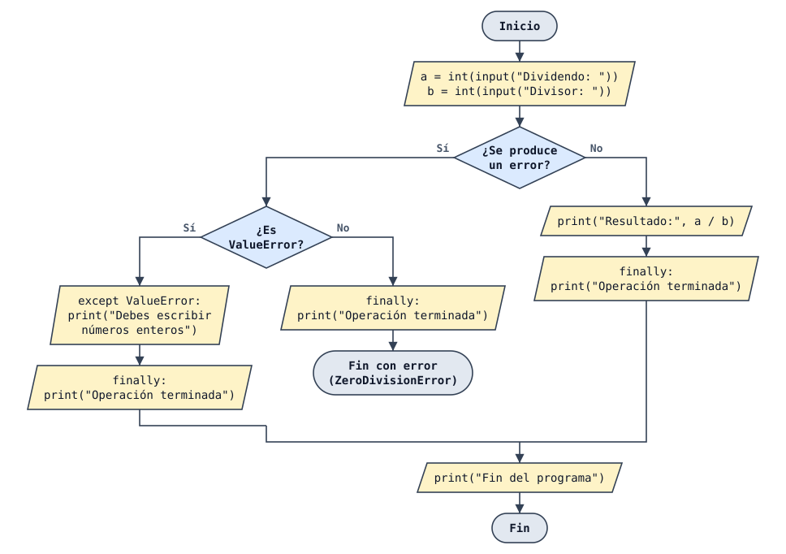

# d) Control de excepciones

## 1. Error, excepción y traza

Cuando algo sale mal durante la ejecución, Python **lanza una excepción** y el programa **se detiene** mostrando un mensaje llamado **traza** (*traceback*).

```text
Traceback (most recent call last):
  File "edad.py", line 2, in <module>
    edad = int(input("Edad: "))
ValueError: invalid literal for int() with base 10: 'abc'
```

**Cómo leer una traza: de abajo hacia arriba.**

1. La **última línea** dice el **tipo de error** y el motivo: `ValueError: invalid literal for int()...`.
2. Las líneas de arriba indican **dónde**: archivo, número de línea y la instrucción que falló.

!!! success "Los errores son información, no fracasos"
    Leer bien la última línea de la traza resuelve la mayoría de los fallos. **Aprende a leerla**: sin internet en los proyectos, será tu guía.

## 2. Tipos de errores

| Tipo | Cuándo aparece | Ejemplo |
|---|---|---|
| **Sintaxis** | **Antes** de ejecutar: el código está mal escrito. | `print("hola"` (falta cerrar el paréntesis) |
| **Ejecución** (excepciones) | **Durante** la ejecución: el código es correcto pero algo falla. | `int("abc")`, `10 / 0` |
| **Lógicos** | El programa funciona pero **da un resultado equivocado**. Python no avisa. | Calcular la media dividiendo entre 2 cuando hay 3 notas |

Los errores de **sintaxis** los corriges tú. Los **lógicos** los detectas probando. Las **excepciones** son las que puedes **controlar** desde el programa.

## 3. Excepciones más comunes

| Excepción | Cuándo ocurre | Ejemplo |
|---|---|---|
| `ValueError` | El valor no se puede convertir o no es válido. | `int("abc")` |
| `TypeError` | Operación con un tipo no permitido. | `"5" + 3` |
| `ZeroDivisionError` | División (o resto) entre cero. | `10 / 0` |
| `NameError` | Se usa una variable que no existe. | `print(saldo)` sin haberla creado |
| `IndexError` | Índice fuera de rango en una secuencia. | `"hola"[10]` |
| `KeyError` | Clave inexistente en un diccionario (UT04). | `datos["clave"]` |
| `FileNotFoundError` | El fichero no existe (UT05). | `open("no_existe.txt")` |

```pycon
>>> 10 / 0
Traceback (most recent call last):
  ...
ZeroDivisionError: division by zero
>>> "hola"[10]
Traceback (most recent call last):
  ...
IndexError: string index out of range
```

## 4. `try` ... `except`

Permite **intentar** un código y **decidir qué hacer si falla**, en lugar de que el programa se detenga.

```python
try:
    edad = int(input("Edad: "))
    print("El año que viene tendrás", edad + 1)
except ValueError:
    print("Eso no es un número entero")

print("El programa continúa")
```

Funcionamiento:

1. Se ejecuta el bloque `try`.
2. Si **no hay error**, se salta el `except`.
3. Si **hay un error** del tipo indicado, se abandona el `try` en ese punto y se ejecuta el `except`.
4. El programa **continúa** después.

### Varios `except`

Cada tipo de error puede tener su propio tratamiento:

```python
try:
    a = int(input("Dividendo: "))
    b = int(input("Divisor: "))
    print("Resultado:", a / b)
except ValueError:
    print("Debes escribir números enteros")
except ZeroDivisionError:
    print("No se puede dividir entre cero")
```

### Agrupar excepciones

```python
try:
    # ...
    pass
except (ValueError, TypeError):
    print("Dato incorrecto")
```

### Ver el mensaje del error

```python
try:
    numero = int(input("Número: "))
except ValueError as error:
    print("Ha ocurrido un error:", error)
```

!!! warning "Captura errores concretos"
    Evita el `except:` a secas (o `except Exception:`) como norma: captura **cualquier** error, incluso los que no esperabas, y esconde fallos reales.
    Indica siempre el tipo (`except ValueError:`).

## 5. Cláusula `finally`

Después de los `except` se puede añadir un bloque `finally`, que se ejecuta **siempre**, haya error o no:

```python
try:
    numero = int(input("Número: "))
    print("Has escrito", numero)
except ValueError:
    print("No es un número")
finally:
    print("Fin del intento")            # SIEMPRE se ejecuta
```

| Cláusula | Se ejecuta... |
|---|---|
| `try` | Siempre, hasta que ocurra un error. |
| `except` | Solo si hubo un error del tipo indicado. |
| `finally` | **Siempre**, haya error o no. Se usa para «limpiar» (cerrar ficheros, conexiones...). |

### ¿Para qué sirve `finally`?

En el ejemplo anterior, el `print("Fin del intento")` daría el mismo resultado escrito **después** del `try`, sin `finally`. Entonces, ¿para qué sirve?

La diferencia aparece cuando el programa **no llega** a la línea siguiente al `try`. `finally` se ejecuta **igualmente** en dos casos en los que el código de después no se ejecuta:

**Caso 1. Se produce un error que ningún `except` captura.**

```python
try:
    a = int(input("Dividendo: "))
    b = int(input("Divisor: "))
    print("Resultado:", a / b)
except ValueError:
    print("Debes escribir números enteros")
finally:
    print("Operación terminada")

print("Fin del programa")
```

Solo se captura `ValueError`. Observa qué pasa con cada entrada:

| Entrada | Salida |
|---|---|
| `10` y `2` | `Resultado: 5.0` → `Operación terminada` → `Fin del programa` |
| `10` y `hola` | `Debes escribir números enteros` → `Operación terminada` → `Fin del programa` |
| `10` y `0` | `Operación terminada` → **traza de `ZeroDivisionError`** y el programa se detiene |

En el tercer caso, el error no se captura y el programa se detiene. Aun así, **antes de detenerse, Python ejecuta el `finally`**. En cambio, `print("Fin del programa")` no llega a ejecutarse.



**Caso 2. Se sale del bucle con `break` desde dentro del `try`.**

```python
while True:
    try:
        texto = input("Número (fin para salir): ")
        if texto == "fin":
            break
        print("El doble es", int(texto) * 2)
    except ValueError:
        print("Eso no es un número")
    finally:
        print("--- intento terminado ---")
```

```text
Número (fin para salir): 4
El doble es 8
--- intento terminado ---
Número (fin para salir): fin
--- intento terminado ---
```

Aunque el `break` saca del bucle, el `finally` se ejecuta **antes de salir**.

!!! tip "¿Cuándo usar `finally`?"
    Para las tareas de **cierre** que no pueden quedarse sin hacer: cerrar un fichero (lo verás en la UT05), desconectarse de un servidor, guardar un registro o avisar al usuario de que la operación ha terminado.

## 6. Lanzar excepciones: `raise`

También **tú** puedes provocar una excepción cuando detectes que algo no es válido:

```python
edad = int(input("Edad: "))

if edad < 0:
    raise ValueError("La edad no puede ser negativa")

print("Edad válida:", edad)
```

Se usa para avisar de una situación incorrecta, y otra parte del programa puede capturarla con `try` / `except`:

```python
try:
    edad = int(input("Edad: "))
    if edad < 0:
        raise ValueError("La edad no puede ser negativa")
    print("Edad válida:", edad)
except ValueError as error:
    print("Error:", error)
```

## 7. Validación de entradas con excepciones

Es el patrón más útil de esta unidad: **pedir un dato hasta que sea válido**.

```python
while True:
    try:
        edad = int(input("Edad: "))
        if edad < 0:
            raise ValueError("La edad no puede ser negativa")
        break                                  # dato válido: salimos del bucle
    except ValueError:
        print("Valor no válido. Inténtalo de nuevo.")

print("Edad registrada:", edad)
```

Cómo funciona:

- `while True` repite la pregunta indefinidamente.
- Si `int()` falla, o si la edad es negativa, salta el `except` y el bucle **vuelve a preguntar**.
- Si todo va bien, se ejecuta `break` y se sale.

!!! tip "Guarda este patrón"
    Se repite en casi todos los programas: menús, cajeros, formularios... En el proyecto de clase lo necesitarás seguro.

## 8. Excepciones personalizadas: introducción

Puedes crear tus propios tipos de excepción **heredando** de `Exception`. Es una «receta» que entenderás del todo en la UT06:

```python
class SaldoInsuficienteError(Exception):
    """Se intenta retirar más dinero del disponible."""


saldo = 50
retirada = 80

try:
    if retirada > saldo:
        raise SaldoInsuficienteError(f"Solo tienes {saldo} €")
except SaldoInsuficienteError as error:
    print("Operación rechazada:", error)
```

Un nombre propio hace que el error sea más descriptivo y fácil de capturar por separado.

## 9. Depuración básica

Depurar es **encontrar y corregir errores**. Tres herramientas:

### a) La traza de error
Léela de abajo arriba, como se vio al principio.

### b) `print()` para «espiar» variables
Añade temporalmente un `print` con el valor de las variables donde sospechas que falla:

```python
print("DEBUG: contador =", contador, "suma =", suma)
```

Cuando lo arregles, **borra** los `print` de depuración.

### c) El depurador de VS Code

Permite ejecutar el programa **paso a paso** viendo el valor de cada variable.

| Acción | Cómo |
|---|---|
| Poner un **punto de interrupción** | Clic a la izquierda del número de línea (aparece un punto rojo) o `F9` |
| Iniciar la depuración | `F5` (o botón *Depurar archivo Python*) |
| Ejecutar la línea actual y pasar a la siguiente | `F10` (*Paso por encima*) |
| Entrar dentro de una función | `F11` (*Paso al interior*) |
| Continuar hasta el siguiente punto de interrupción | `F5` |
| Detener | `Shift+F5` |

El panel **Variables** (a la izquierda) muestra los valores actuales. Con él puedes comprobar «traza a mano» tus bucles.

!!! info "En Jupyter"
    Las celdas también se pueden depurar con el botón **Depurar celda** de VS Code. Si no, ejecuta las celdas de una en una e inspecciona las variables escribiendo su nombre en la celda siguiente.

## Resumen

- Una **excepción** detiene el programa y muestra una **traza**: lee la última línea primero.
- Errores de **sintaxis**, de **ejecución** (excepciones) y **lógicos**.
- `try` / `except` captura errores concretos; `finally` se ejecuta siempre, incluso si el error no se captura o se sale con `break`.
- `raise` lanza una excepción.
- Patrón de validación: `while True` + `try` / `except` + `break`.
- Depura con la traza, `print()` y el depurador de VS Code.
