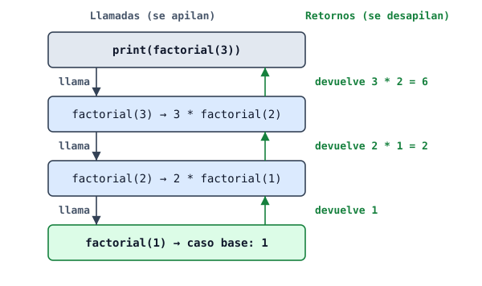

# b) Recursividad

## 1. ¿Qué es la recursividad?

Una función es **recursiva** cuando **se llama a sí misma**. La idea es resolver un problema reduciéndolo a **una versión más pequeña del mismo problema**, hasta llegar a un caso tan sencillo que se resuelve directamente.

Piensa en unas **muñecas rusas** (*matrioskas*): para llegar a la más pequeña, abres una muñeca y dentro hay otra igual pero más pequeña; repites lo mismo hasta que encuentras una que ya no se abre.

Compara una cuenta atrás hecha con un bucle y hecha con recursividad:

```python
# Iterativa: con un bucle
def cuenta_atras(n):
    while n > 0:
        print(n)
        n -= 1
    print("¡Despegue!")
```

```python
# Recursiva: la función se llama a sí misma
def cuenta_atras(n):
    if n == 0:
        print("¡Despegue!")      # caso base: se para
    else:
        print(n)
        cuenta_atras(n - 1)      # caso recursivo: problema más pequeño
```

```text
3
2
1
¡Despegue!
```

Las dos dan el mismo resultado con `cuenta_atras(3)`. La versión recursiva no tiene bucle: la repetición sale de que **cada llamada hace otra llamada** con un número menor.

| | Iteración | Recursividad |
|---|---|---|
| Cómo repite | Con un bucle (`while`, `for`). | La función se llama a sí misma. |
| Cómo para | Cuando la condición del bucle es falsa. | Cuando se llega al **caso base**. |
| Memoria | Usa siempre la misma. | Cada llamada ocupa memoria hasta que termina. |

!!! success "Ahora tú"
    **Escalera de un videojuego.** Un personaje baja una escalera de `n` peldaños. Escribe dos versiones de la función `bajar(n)`, una con `while` y otra **recursiva**, que muestren:

    ```text
    Peldaño 4
    Peldaño 3
    Peldaño 2
    Peldaño 1
    ¡En el suelo!
    ```

    Después, cambia la versión recursiva para que muestre los peldaños **subiendo** (`1, 2, 3, 4` y `¡Arriba!`) moviendo solo el `print` de sitio. Pista: ¿qué pasa si el `print` va **después** de la llamada recursiva?

## 2. Estructura de una función recursiva

Toda función recursiva necesita **dos partes**:

| Parte | Qué hace | En `cuenta_atras` |
|---|---|---|
| **Caso base** | Resuelve directamente el caso más sencillo, **sin** llamarse a sí misma. Es lo que hace que la recursividad termine. | `if n == 0:` muestra `¡Despegue!` |
| **Caso recursivo** | Se llama a sí misma con un problema **más pequeño**, que se acerca al caso base. | `cuenta_atras(n - 1)` |

```text
def funcion_recursiva(problema):
    si el problema es el caso más sencillo:            ← caso base
        devolver la solución directa
    si no:                                             ← caso recursivo
        usar funcion_recursiva(problema más pequeño)
        para construir la solución
```

Ejemplo: sumar los números del 1 al `n`. La suma del 1 al 5 es **5 + (la suma del 1 al 4)**, y así hasta llegar a la suma del 1 al 1, que es 1:

```python
def suma_hasta(n):
    """Devuelve 1 + 2 + ... + n."""
    if n == 1:                      # caso base
        return 1
    return n + suma_hasta(n - 1)    # caso recursivo


print(suma_hasta(5))                # 15
```

!!! warning "Las dos preguntas antes de escribir una función recursiva"
    1. ¿Cuál es el caso **más sencillo**, el que sé resolver sin pensar? → **caso base**.
    2. Si supiera resolver el problema un poco más pequeño, ¿cómo lo usaría para resolver el grande? → **caso recursivo**.

    Y comprueba que cada llamada se **acerca** al caso base. Si no, la función no terminará nunca.

!!! success "Ahora tú"
    **Encuentra las partes.** Para cada función, señala con un comentario el caso base y el caso recursivo, y explica qué calcula. Después, comprueba tu respuesta ejecutándola con varios valores.

    ```python
    def misterio_a(n):
        if n == 0:
            return 0
        return 2 + misterio_a(n - 1)


    def misterio_b(texto):
        if texto == "":
            return 0
        return 1 + misterio_b(texto[1:])
    ```

    Pista: `texto[1:]` es el texto **sin su primer carácter** (lo verás en la UT04).

## 3. Ejemplos clásicos

### Factorial

El factorial de `n` (se escribe `n!`) es el producto de todos los enteros del 1 al `n`: `4! = 4 · 3 · 2 · 1 = 24`. Se cumple que `n! = n · (n - 1)!`, y por definición `0! = 1! = 1`.

```python
def factorial(n):
    """Devuelve el factorial de n (n >= 0)."""
    if n <= 1:                        # caso base: 0! = 1! = 1
        return 1
    return n * factorial(n - 1)       # caso recursivo


print(factorial(3))                   # 6
```

Para calcular `factorial(3)` hace falta `factorial(2)`, que necesita `factorial(1)`. Las llamadas **se quedan esperando** hasta que se llega al caso base; después, cada una recibe el resultado de la siguiente y termina su cálculo:



```text
factorial(3) = 3 * factorial(2)
                   factorial(2) = 2 * factorial(1)
                                      factorial(1) = 1        ← caso base
                   factorial(2) = 2 * 1 = 2
factorial(3) = 3 * 2 = 6
```

### Sucesión de Fibonacci

Cada número es la **suma de los dos anteriores**: 0, 1, 1, 2, 3, 5, 8, 13, 21... Tiene **dos** casos base y **dos** llamadas recursivas:

```python
def fibonacci(n):
    """Devuelve el término n de la sucesión (fibonacci(0) = 0)."""
    if n < 2:                                   # casos base: 0 y 1
        return n
    return fibonacci(n - 1) + fibonacci(n - 2)  # caso recursivo


for i in range(10):
    print(fibonacci(i), end=" ")                # 0 1 1 2 3 5 8 13 21 34
```

!!! warning "Fibonacci recursivo es muy lento"
    Cada llamada hace **otras dos**, y muchas se repiten: `fibonacci(5)` calcula `fibonacci(3)` dos veces y `fibonacci(2)` tres veces. Para `fibonacci(30)` se hacen **más de 2,6 millones** de llamadas. La versión con un bucle hace solo 30 vueltas.

### Potencia

`base` elevado a `exponente` es `base` multiplicado por `base` elevado a `exponente - 1`, y cualquier número elevado a 0 es 1:

```python
def potencia(base, exponente):
    """Devuelve base ** exponente (exponente >= 0)."""
    if exponente == 0:
        return 1
    return base * potencia(base, exponente - 1)


print(potencia(2, 10))                # 1024
```

### Suma de las cifras de un número

La última cifra de un número es `n % 10` y el número sin esa cifra es `n // 10`:

```python
def suma_cifras(n):
    """Devuelve la suma de las cifras de n (n >= 0)."""
    if n < 10:                            # una sola cifra
        return n
    return n % 10 + suma_cifras(n // 10)


print(suma_cifras(4721))                  # 4 + 7 + 2 + 1 = 14
```

### Invertir una cadena

El texto invertido es **el resto del texto invertido** seguido de **la primera letra**:

```python
def invertir(texto):
    """Devuelve el texto al revés."""
    if len(texto) <= 1:                   # vacío o una letra: ya invertido
        return texto
    return invertir(texto[1:]) + texto[0]


print(invertir("python"))                 # nohtyp
```

### Torres de Hanói

Hay tres varillas (A, B y C) y `n` discos de distinto tamaño apilados en A, de mayor a menor. Hay que pasarlos todos a C con dos reglas: se mueve **un disco cada vez** y **nunca** puede quedar un disco grande sobre uno pequeño.

```text
     |            |            |
    =|=           |            |
   ==|==          |            |
  ===|===         |            |
 ──────────   ──────────   ──────────
     A            B            C
```

Pensarlo paso a paso es complicado, pero de forma recursiva es sencillo. Para mover `n` discos de A a C:

1. Mueve los `n - 1` discos de arriba de A a **B** (usando C como ayuda).
2. Mueve el disco más grande de A a **C**.
3. Mueve los `n - 1` discos de B a **C** (usando A como ayuda).

Los pasos 1 y 3 son **el mismo problema con un disco menos**. El caso base es un solo disco, que se mueve directamente.

```python
def hanoi(n, origen, destino, auxiliar):
    """Muestra los movimientos para pasar n discos de origen a destino."""
    if n == 1:
        print(f"Mueve el disco 1 de {origen} a {destino}")
        return
    hanoi(n - 1, origen, auxiliar, destino)
    print(f"Mueve el disco {n} de {origen} a {destino}")
    hanoi(n - 1, auxiliar, destino, origen)


hanoi(3, "A", "C", "B")
```

```text
Mueve el disco 1 de A a C
Mueve el disco 2 de A a B
Mueve el disco 1 de C a B
Mueve el disco 3 de A a C
Mueve el disco 1 de B a A
Mueve el disco 2 de B a C
Mueve el disco 1 de A a C
```

Con `n` discos hacen falta `2ⁿ - 1` movimientos: 7 con 3 discos, 1023 con 10 discos.

!!! success "Ahora tú"
    **Tres funciones recursivas.** Escribe estas funciones **sin bucles** y pruébalas con `assert`:

    1. `multiplicar(a, b)`: multiplica dos enteros no negativos usando solo sumas (`a * b = a + a * (b - 1)`). `multiplicar(4, 3)` → `12`.
    2. `contar_cifras(n)`: devuelve cuántas cifras tiene un entero no negativo. `contar_cifras(90210)` → `5`, `contar_cifras(7)` → `1`.
    3. `mcd(a, b)`: máximo común divisor con el **algoritmo de Euclides**: si `b` es 0, el resultado es `a`; si no, es `mcd(b, a % b)`. `mcd(48, 18)` → `6`.

    **Reto:** cambia `hanoi` para que, en lugar de mostrar los movimientos, **devuelva** cuántos ha hecho. Comprueba que con 3 discos devuelve 7 y con 10 discos, 1023.

## 4. Pila de llamadas y límite de recursión

Cada vez que se llama a una función, Python guarda en la **pila de llamadas** (*call stack*) sus variables locales y el punto al que debe volver. Mientras una llamada espera el resultado de otra, sigue ocupando su sitio en la pila.

En el panel **Pila de llamadas** de VS Code puedes verlo: pon un punto de interrupción en el caso base de `factorial` y ejecuta `factorial(5)`. Verás cinco llamadas apiladas, una encima de otra.

Si la recursividad **no llega nunca al caso base**, la pila crece sin parar. Para evitar que el programa se quede sin memoria, Python limita el número de llamadas encadenadas (unas **1000** por defecto) y, al superarlo, lanza `RecursionError`:

```python
def factorial(n):
    return n * factorial(n - 1)       # ¡sin caso base!


factorial(5)
```

```text
Traceback (most recent call last):
  ...
  File "factorial.py", line 2, in factorial
    return n * factorial(n - 1)
  [Previous line repeated 996 more times]
RecursionError: maximum recursion depth exceeded
```

Las causas más habituales:

| Causa | Ejemplo |
|---|---|
| Falta el caso base. | El ejemplo anterior. |
| El caso recursivo **no se acerca** al caso base. | `return n * factorial(n + 1)` |
| Un dato que **se salta** el caso base. | `factorial(-3)` con `if n == 1:` como caso base: -3, -4, -5... nunca llega a 1. |
| El problema es **demasiado grande**, aunque esté bien escrito. | `suma_hasta(5000)` necesita 5000 llamadas encadenadas. |

!!! tip "Protege tus funciones recursivas"
    Comprueba los datos **antes** de empezar y lanza una excepción si no son válidos:

    ```python
    def factorial(n):
        if n < 0:
            raise ValueError("No existe el factorial de un número negativo")
        if n <= 1:
            return 1
        return n * factorial(n - 1)
    ```

!!! note "Se puede cambiar el límite, pero no es la solución"
    `sys.getrecursionlimit()` muestra el límite y `sys.setrecursionlimit()` lo cambia. Subirlo solo sirve si sabes que tu problema necesita un poco más de profundidad; si la función no termina nunca, seguirá sin terminar.

!!! success "Ahora tú"
    **Rompe la recursividad a propósito.** Partiendo de la función `potencia` del apartado 3:

    1. Quita el caso base, ejecútala con `potencia(2, 5)` y lee la traza. ¿Qué línea se repite? ¿Cuántas veces?
    2. Vuelve a ponerlo y prueba `potencia(2, -1)`. ¿Por qué falla si el caso base está?
    3. Añade una comprobación que lance `ValueError` con un mensaje claro si el exponente es negativo, y captúrala con `try` / `except` en el programa principal.
    4. Ejecuta `import sys` y `print(sys.getrecursionlimit())` para ver el límite de tu instalación.

## 5. ¿Cuándo usar recursividad?

| Ventajas | Inconvenientes |
|---|---|
| Código **más corto y claro** en problemas que tienen forma recursiva (Hanói, carpetas dentro de carpetas, árboles...). | Más **lenta** y gasta más **memoria** que un bucle: cada llamada ocupa un sitio en la pila. |
| Se parece a la **definición matemática** del problema (`n! = n · (n - 1)!`). | Tiene un **límite** de llamadas encadenadas (`RecursionError`). |
| Algunos problemas son muy difíciles de resolver sin ella. | Puede repetir cálculos sin darse cuenta (Fibonacci). |
| | Es más difícil de **seguir y depurar** al principio. |

**Regla práctica:**

- Si el problema se resuelve fácil con un **bucle** (sumar, contar, recorrer), usa un bucle.
- Usa recursividad cuando el problema **se divide de forma natural** en subproblemas iguales y más pequeños, y la profundidad no es muy grande: las torres de Hanói, recorrer las carpetas de un disco (UT05), explorar un laberinto...

!!! info "Todo lo recursivo se puede hacer con bucles"
    Cualquier función recursiva se puede reescribir con bucles, y al revés. Elegir una u otra es cuestión de **claridad** y **eficiencia**.

!!! success "Ahora tú"
    **Carrera entre versiones.** Escribe `fibonacci_iterativo(n)` con un bucle `for` y dos variables que guarden los dos últimos términos. Después, compara el tiempo de las dos versiones:

    ```python
    import time

    inicio = time.perf_counter()
    resultado = fibonacci(30)
    fin = time.perf_counter()
    print(f"Recursivo: {resultado} en {fin - inicio:.4f} s")
    ```

    Repite la medida con `fibonacci_iterativo(30)` y con `n = 32` y `n = 34`. ¿Cuánto crece el tiempo de cada versión? Explica la diferencia en un comentario.

## Resumen

- Una función **recursiva** se llama a sí misma con un problema **más pequeño**.
- Necesita un **caso base** (se resuelve sin llamarse) y un **caso recursivo** (se llama acercándose al caso base).
- Cada llamada ocupa un sitio en la **pila de llamadas** hasta que termina. Sin caso base, se produce `RecursionError`.
- Ejemplos clásicos: factorial, Fibonacci, potencia, suma de cifras, invertir una cadena y torres de Hanói.
- Usa recursividad cuando el problema tiene forma recursiva y la profundidad es pequeña; en el resto de casos, un bucle es más eficiente.
